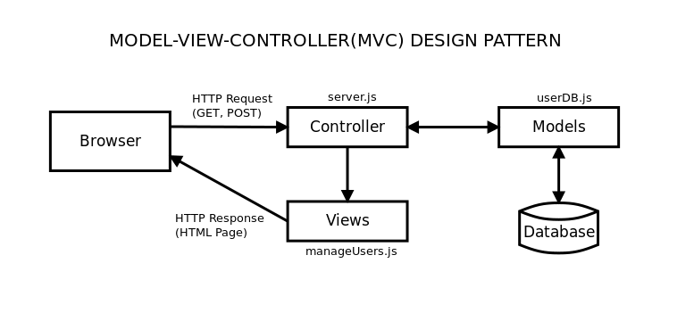
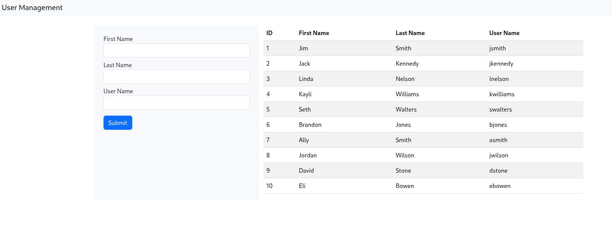

## Assignment 7: Simple Model-View-Controller Database Backend Modification

This repository contains the Simple MVC Application from week 6.  This Application has just an array of JSON objects in the `userDB.js` file.  This is the model file in MVC and it contains all of the database interaction.  You will need to use **callbacks** for your MySQL2 calls, **Not Promises**. You need to make the following modifications to this application:
1. Install the MySQL2 Library to your project
```
npm install mysql2
,,,
2. Add the database connection code to your `userDB.js` file. All of the required connection values are in the `assignDB.sql` file. (Refer to the MYSQL2 Documentation)
3. Convert your `getUsers()` function to execute the SQL and return the array of user JSON objects.  Update your View, `manageUsers.ej` to display all of the columns correctly. (Refer to the MYSQL2 Documentation)
4. Convert your `addUser()` function to store the new user in the **users** table. (Refer to the MYSQL2 Documentation)



To Create the assignDb database
```
sudo mysql < assignDB.sql
```
To run the application.  Clone the repository to your VM.and from the repository directory:
```
node server.js
```
From the browser: HTTP://localhost:3000

#### User Management View


